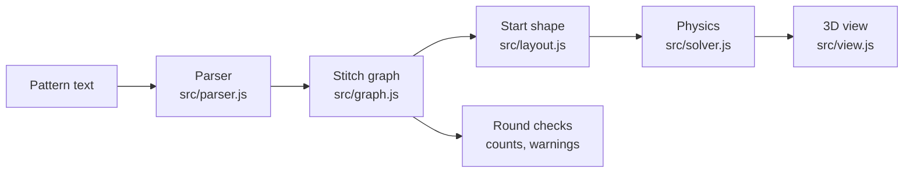

# Looplab

Type a crochet pattern. See the 3D piece before you make it.

Looplab reads a pattern written the way crocheters write it (`R3: (sc, inc) x6 (18)`), checks every stitch count, and grows a 3D model of the piece with a small physics simulation. Change one round and the model changes with it.

## Try it

Open `index.html` through a local web server (browsers do not load modules from `file://`):

```
python -m http.server 8000
```

Then open http://localhost:8000.

On GitHub, turn on **Settings → Pages → Deploy from branch → main / root** and the same page is live at `https://<user>.github.io/<repo>/`.

## Write a pattern

| What | How |
|---|---|
| Magic ring | `R1: mr, 6 sc` |
| Stitches | `sc` `hdc` `dc` `tr` `sl st` `ch` |
| Many of one | `6 sc` or `sc x6` |
| Increase | `inc`, `2 sc in next`, `hdc inc` |
| Decrease | `dec`, `invdec`, `sc2tog`, `hdc2tog` |
| Repeat | `(sc, inc) x6` or `*sc, inc* 6 times` |
| Fill the round | `sc around`, `(sc, inc) around`, `sc in each st around` |
| Many rounds | `R7-R12: sc around` |
| Check a count | end the line with `(18)` |
| Rows | `ch 11`, then `Row 1: sc in 2nd ch from hook, sc x9, turn` |
| Yarn color | a line `color: teal` (any CSS color name or hex) |
| UK terms | a line `terms: uk` |
| Letter symbols | `X` sc, `T` hdc, `F` dc, `E` tr, `CH` chain, `K` skip, `SL` sl st |
| Symbol inc / dec | after a stitch letter, or alone for sc: `V` 2 in one, `W` 3 in one, `A` 2 together, `M` 3 together (`FV`, `TA`, `V`) |
| Symbol counts | `12FV`, `FV12`, `12(2F, FV)`, `K6` |
| Close the end | `FO, close the hole` |
| Comment | `# anything` |

Rounds are worked as a continuous spiral. Rows turn at the end of each row.

Not supported yet: joined rounds, front or back loop only, puff / bobble / popcorn, chain spaces.

## How it works



1. **Parser.** Turns each line into operations: stitch, chain, skip, repeat, "around".
2. **Stitch graph.** Every stitch is a node. Edges connect a stitch to the stitch made just before it (`prev`, one stitch width) and to the stitch it is worked into (`parent`, one stitch height). Soft `bend` links stop the fabric from folding flat on itself. Triangles between rows make the surface.
3. **Start shape.** Each round starts as a ring with circumference = stitch count × stitch width, one stitch height above the round below (the "ring model"). Rows start as a flat sheet.
4. **Physics.** Position-based dynamics (XPBD). Each step moves the stitches, pulls every edge back to its rest length, pushes apart stitches that come too close, and adds stuffing pressure on the surface. The solver removes slow spin and stops when the shape no longer changes.
5. **View.** three.js draws the surface in the yarn colors, with optional stitch lines and round stripes.

### Stitch sizes

Sizes are in stitch widths. They are set so that the classic flat circles stay flat: 6 sc, 8 hdc or 12 dc increases per round.

| Stitch | Height |
|---|---|
| sc | 0.95 |
| hdc | 1.25 |
| dc | 1.9 |
| tr | 2.5 |
| sl st | 0.4 |

Size in cm uses the gauge field: `cm = stitch widths × 10 / (sc per 10 cm)`.

## Develop

```
npm install
npm test             # parser, graph and shape tests (node --test)
npm run build        # writes index.html and dist/looplab.html (one-file page)
node scripts/check.mjs index.html shots   # headless Chrome screenshots of every example
```

```
src/
  parser.js    pattern text -> operations
  graph.js     operations -> stitch graph, checks
  layout.js    start positions
  solver.js    physics
  view.js      three.js drawing
  presets.js   example patterns
  main.js      page wiring
app.html       page markup and styles (source for index.html and dist/)
test/          node --test suites
```

## Roadmap

- **Pattern coverage:** joined rounds (`sl st to first st, ch 1`), front/back loop only, turning chains that count as a stitch, chain spaces, clusters (puff, bobble, popcorn), granny squares.
- **Realism:** draw real yarn (a tube along the yarn path, a V on top of each stitch); calibrate stitch sizes from photos of real swatches; gravity and a table surface.
- **Pieces:** several parts in one file (head, body, arms) and where to sew them together.
- **Sharing:** link that carries the pattern, export to OBJ / GLB / STL.
- **Reverse direction:** draw a shape, get a pattern.

## Credits

Ideas from Tim Hutton's [crochet-simulator](https://github.com/timhutton/crochet-simulator) (a stitch graph relaxed with springs and an inflation term) and from [CrochetPARADE](https://www.crochetparade.org/). No code is copied from either project. Background reading: AmiGo (Edelstein et al., 2022), Greer & Mould (2025), Seitz et al. (2021).

## License

MIT. See `LICENSE`.
